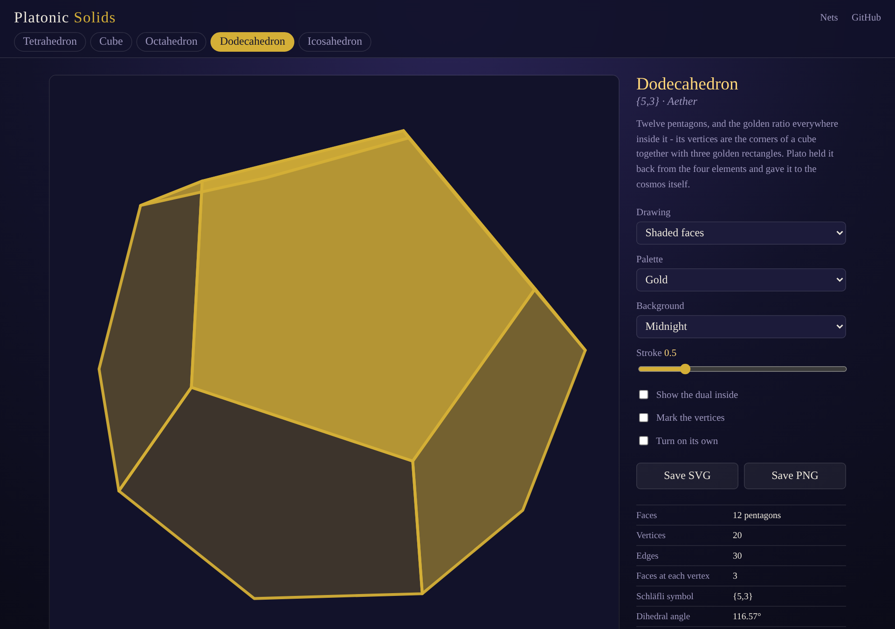
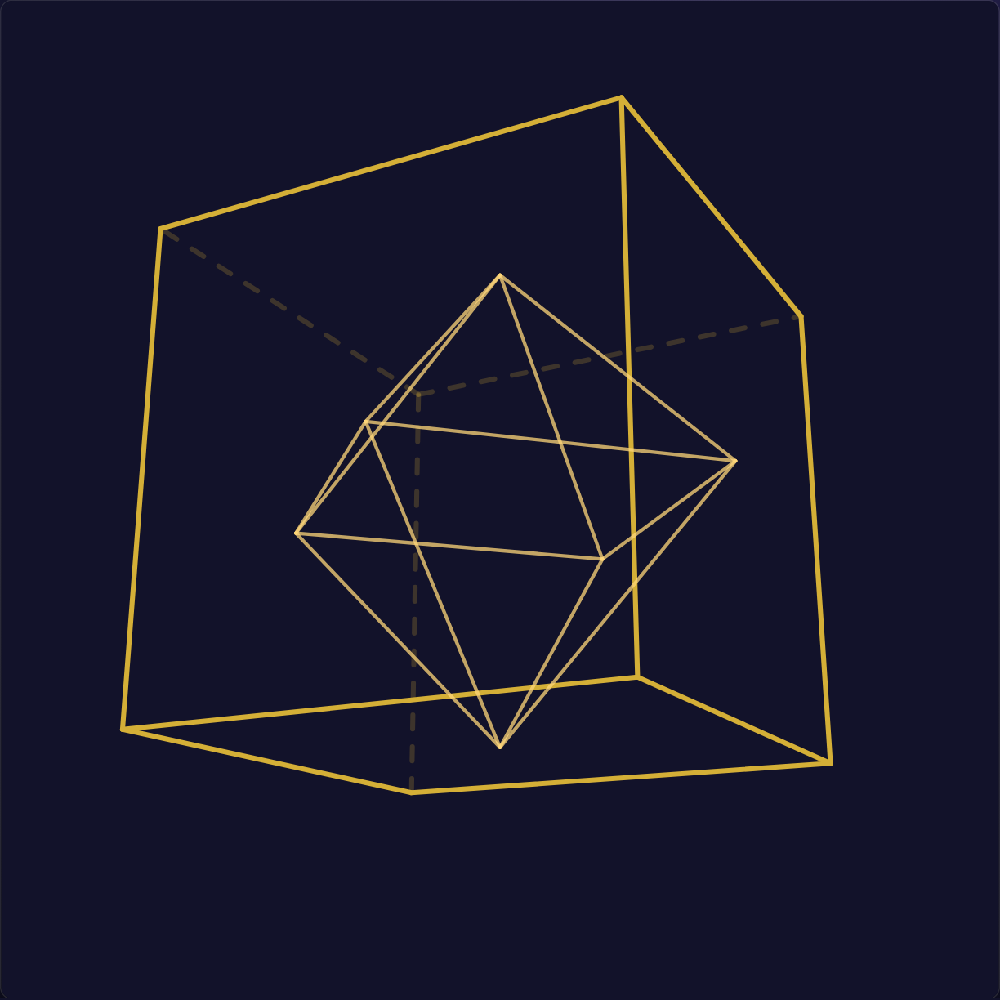
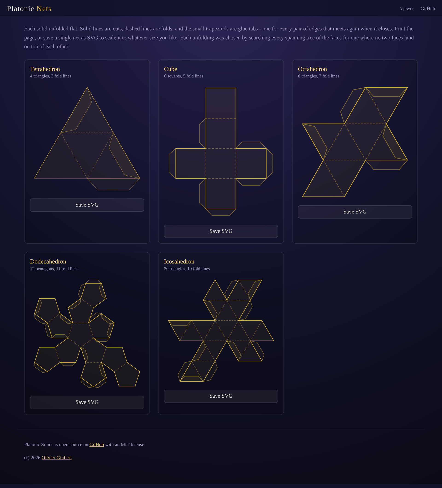

# Platonic-Solids

Turn the five Platonic solids in 3D, show their duals, read their measurements, and print the nets to fold your own. Everything is computed from the vertex coordinates alone - no libraries, no 3D engine, no hand-drawn diagrams.

- [Turn the solids](https://evoluteur.github.io/platonic-solids/)
- [Print the nets](https://evoluteur.github.io/platonic-solids/nets.html)

## The five

| Solid        | Schläfli | Faces        | Vertices | Edges | Dihedral | Dual         | Element |
| ------------ | -------- | ------------ | -------- | ----- | -------- | ------------ | ------- |
| Tetrahedron  | {3,3}    | 4 triangles  | 4        | 6     | 70.53°   | itself       | Fire    |
| Cube         | {4,3}    | 6 squares    | 8        | 12    | 90°      | Octahedron   | Earth   |
| Octahedron   | {3,4}    | 8 triangles  | 6        | 12    | 109.47°  | Cube         | Air     |
| Dodecahedron | {5,3}    | 12 pentagons | 20       | 30    | 116.57°  | Icosahedron  | Aether  |
| Icosahedron  | {3,5}    | 20 triangles | 12       | 30    | 138.19°  | Dodecahedron | Water   |

There are exactly five, and there is no sixth: at three faces per vertex the angles still leave room to fold, and past a point they add up to a full turn and the corner falls flat. Euclid closes the Elements with the proof.

## The viewer

Drag to turn a solid, or let it turn on its own. Switch between shaded faces and a wireframe where the hidden edges show as faint dashes. Tick **Show the dual inside** to see the partner solid inscribed with its vertices exactly on the face centres - cube and octahedron, dodecahedron and icosahedron, and the tetrahedron with a copy of itself. Six palettes, four backgrounds, and SVG or 2048px PNG export.

## The nets

Solid lines are cuts, dashed lines are folds, and the trapezoids are glue tabs - one for each pair of edges that meets again when the net closes. Print the page, or save any single net as SVG and scale it to whatever size you like.

## How it works

Only the vertex coordinates are written down - four points for the tetrahedron, twenty for the dodecahedron. Everything else is derived:

- **Faces** come from a small convex-hull routine: any plane through three vertices that leaves every other vertex on one side is a face, and the vertices on that plane are wound counter-clockwise as seen from outside. The same function builds all five solids and their duals.
- **Duals** are the convex hull of the face centres, scaled to sit exactly on them.
- **Measurements** - dihedral angle, circumradius, inradius, midradius - are measured off the geometry, not looked up. They agree with the classical values to six decimals, and V − E + F = 2 for all five.
- **Nets** are built by walking a spanning tree of the face-adjacency graph and hinging each face into the plane about the edge it shares with its parent. Every root and visit order was searched offline for an unfolding where no two faces land on top of each other; the winning one is recorded per solid.
- **3D** is a rotation matrix, a perspective divide, and a painter's-algorithm sort, drawn as plain SVG polygons. Back faces are culled - the solids are convex, so a back face is never visible. No WebGL, no `<canvas>` - it runs in any browser that can draw SVG.

Plain HTML, CSS, and JavaScript, without external dependencies, and a Progressive Web App (PWA): you can install it on your phone or computer from the browser, and it works offline.

## License

Platonic Solids is Open Source at [GitHub](https://github.com/evoluteur/platonic-solids) with MIT license.

Had fun browsing the app? [Buy me a coffee by becoming a sponsor](https://github.com/sponsors/evoluteur).

You may also be interested in my other projects [Kepler's Cosmic Cup](https://github.com/evoluteur/keplers-cosmic-cup), [Sacred Geometry](https://github.com/evoluteur/sacred-geometry), [Mandala Maker](https://github.com/evoluteur/mandala-maker), [Healing Frequencies](https://github.com/evoluteur/healing-frequencies), [Binaural Beats](https://github.com/evoluteur/binaural-beats), [Cymatics](https://github.com/evoluteur/cymatics), [Motivational Numerology](https://github.com/evoluteur/motivational-numerology), and [Archimedean Solids](https://github.com/evoluteur/archimedean-solids). See them all on [Esoterica](https://evoluteur.github.io/esoterica.html).

(c) 2026 [Olivier Giulieri](https://evoluteur.github.io/)
